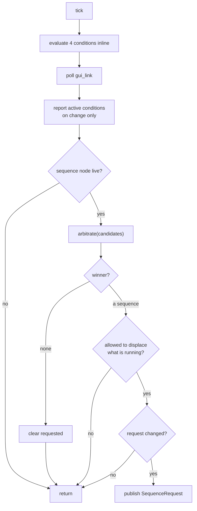
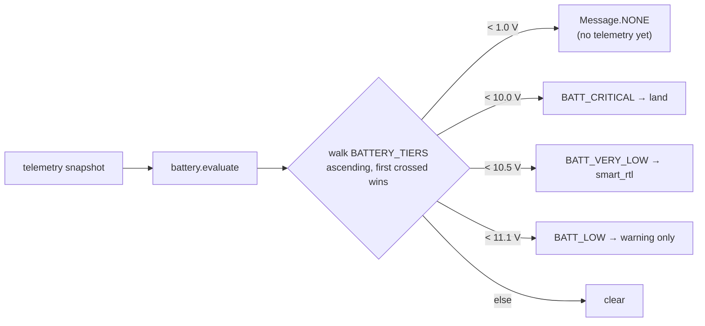

# Architecture

What this stack is, why it is shaped this way, and where it is not yet ready.

---

## 1. The pattern and its name

This is a **hybrid deliberative/reactive architecture** — specifically the
**three-tiered (3T)** form, the standard decomposition for autonomous robots
that must both plan and react. Its tiers have established names, and they map
onto this stack one for one:

| 3T tier | Here | Owns |
|---|---|---|
| **Deliberation** | `udl_aa_fc` | What *should* happen — safety conditions, operator intent, arbitration |
| **Sequencing** | `udl_aa_seqs` | Running one multi-step plan at a time, and preempting it |
| **Reactive skills** | `udl_aa_fs` | Executing primitives, fast, with no memory |

The middle tier is called the *sequencing layer* in the literature, which is
exactly what `udl_aa_seqs` is. Below the stack, ArduPilot is the servo loop.

The arbitration in the top tier is **priority-based behaviour arbitration** —
the same idea as `twist_mux`, applied to goals rather than velocity streams. The
`udl_aa_fc` ↔ `udl_aa_seqs` contract is the **goal-delegation pattern**: a client
submits a goal, a server accepts or refuses it, executes, and reports a terminal
state. ROS 2 actions are the same pattern; this implements it on plain topics,
for reasons in §6.

```
                                 WHAT          HOW                 DO
    operator ──┐
               ├──  udl_aa_fc  ──────►  udl_aa_seqs  ──────►  udl_aa_fs  ──► ArduPilot
    telemetry ─┘    deliberation       sequencing            reactive
                    decides            runs one              executes
                    runs nothing       at a time             remembers nothing
```

---

## 2. Philosophy

Five ideas do most of the work. Each one is a constraint that removes a class of
bug rather than a feature that adds behaviour.

### Each tier knows strictly less than the one above

`udl_aa_fs` treats the token as opaque — never masked, never shifted, never
compared — and `msg.sequence` reaches only a log line. `udl_aa_seqs` knows
sequence names but nothing about why one was asked for. `udl_aa_fc` knows why but
runs nothing.

That monotonic ignorance is what makes the lower tiers trustworthy. A tier that
understood the tier above it would need changing every time the one above
changed, and an arbiter you have to keep editing is an arbiter you cannot
verify.

### Make invariants structural, not conventional

"Only one sequence runs at a time" used to be an agreement between three
components. Now `udl_aa_seqs` is the only thing that runs sequences and the only
thing that publishes `VehicleCommand`, so two sequences *cannot* fight over the
vehicle regardless of how many things ask.

An invariant enforced by shape survives refactoring; an invariant enforced by
comment does not.

### One table, not two stages

Safety and operator intent are ranked together, in one `max()` over one dict:

```python
key = lambda sequence: PRIORITY.get(sequence, UNKNOWN)
```

Ranking safety first and then ranking its winner against the operator is two
places to be wrong and a window in which they disagree. "Safety outranks the
operator" falls out of the ordering — operator sequences sit at the bottom,
`abort` at the top — rather than being a separate check someone can forget.

### Pure functions wherever the decision lives

Every safety condition is `evaluate(telemetry, limits, state) -> Verdict`: no
ROS, no threads, no clock, no I/O. Every battery band was tested by constructing
a namespace, with no simulator running.

That matters more here than anywhere else in the stack, because safety logic
that is expensive to test is safety logic that does not get tested. The same
signature is what a thread would call, so a condition that later becomes
expensive — polygonal geofencing — moves onto its own thread without anything
else noticing.

### Define wording and action on one row

```python
BATT_CRITICAL = SafetyMessage('battery critical', Sequence.LAND)
```

What the operator reads and what the vehicle does are declared together and
cannot drift apart. Two tables would eventually disagree, and the disagreement
would surface as an operator being told one thing while the vehicle did another.

### Inherit failsafes rather than write them

Silence stops the vehicle: stop refreshing a setpoint and ArduPilot brakes after
`GUID_TIMEOUT`. The last-resort failsafe is ArduPilot's own GCS failsafe,
configured rather than coded. Less of our code in the path that must not fail.

---

## 3. The commander's tick



Two gates decide everything. The whole tick is *publish, or do not*.

### Gate 1 — may it displace the incumbent?

| Running | Candidate | Publish |
|---|---|---|
| nothing | anything | **yes** |
| something | `abort` | **yes** — including over safety |
| something | the same sequence | **yes** — an update, not displacement |
| something | strictly more severe | **yes** |
| something | equal or lower | no |

Equal priority never displaces. That single choice is what stops a condition
flickering across its threshold from restarting a sequence, and what stops a
*clearing* condition from abandoning the response to it — a battery that sagged
under load and recovered when the vehicle slowed has not stopped being a reason
to come home.

The same-sequence exception is not a special case for manual; it is what makes
"an update to what is already running" expressible at all. Without it a released
d-pad could not send its zeros, and the vehicle would hold its last setpoint
until `GUID_TIMEOUT`.

### Gate 2 — has anything changed?

Publish on change only. A standing condition asks every tick; republishing at
20 Hz would make the sequence node responsible for deduplicating.

It also removes a whole class of bug for free: a sequence that ended is *not*
immediately asked for again, because the candidate has not changed. A battery
still critical after landing does not land twice.

---

## 4. Severity, and how a condition decides

A condition never names a sequence. It grades itself into a band, the band names
a message, and the message carries the sequence.



The `INVALID` row is not a battery band. Before the first telemetry message the
whole snapshot reads zero, and 0.0 V means nobody is talking to this vehicle
rather than a flat pack — without that row a fresh start would command `land` on
its first tick. Giving "no data" its own row resolves it through the same table
walk as everything else, which is why the function has no guard clause.

The ladder, lowest to highest:

```
warning  <  smart_rtl  <  rtl  <  land  <  emergency_land  <  motor_cutoff  <  abort
```

Ranking is over the **sequence**, not the condition, so a battery asking to land
outranks a fence asking to return regardless of which raised it. A warning ranks
lowest and carries no sequence, so it names itself to the operator and wins
nothing — needing no special case anywhere.

---

## 5. A response, end to end

Traced from the real test, not from intent:

```mermaid
sequenceDiagram
    participant FS as udl_aa_fs
    participant FC as udl_aa_fc
    participant SQ as udl_aa_seqs
    FS->>FC: VehicleTelemetry (5 Hz, battery 9.5 V)
    Note over FC: battery.evaluate → BATT_CRITICAL → land
    Note over FC: arbitrate → land; nothing running → allowed
    FC->>SQ: SequenceRequest{sequence: land, token: 1}
    Note over SQ: registry lookup, on_start
    SQ->>FS: VehicleCommand{LAND, token: 262145}
    SQ-->>FC: SequenceStatus{land, RUNNING, 1}
    FS-->>SQ: VehicleStatus{ACCEPTED}
    Note over SQ: watch only — LAND left GUIDED
    FS->>SQ: telemetry: not in_air, not armed
    SQ-->>FC: SequenceStatus{land, COMPLETE, 1}
```

Two token spaces, deliberately. `token: 1` identifies the *request*; `262145` is
`(seq_id 4 << 16) | cmd_id 1` and identifies the *command*. One request spans
however many commands the sequence issues, which is what lets the commander
match an outcome to its own request while the flight stack matches a rejection
to one command.

`SequenceStatus` publishes every tick, including when nothing is running. The
commander needs "nothing is running" as a positive fact for gate 1, and an
event-only topic could not give it that after a dropped message.

---

## 6. Trade-offs taken deliberately

**Topics rather than ROS 2 actions.** The goal-delegation pattern is what actions
exist for — goal UUIDs, accept/reject, preemption, terminal states — and this
reimplements a thin version of it. Topics were chosen because they match the
rest of the stack, are trivially inspectable with `ros2 topic echo`, and carry
no hidden lifecycle. The cost is a hand-rolled token and no cancel semantics or
feedback channel.

**No latch in the flight stack.** Holding the vehicle for a sequence id across
silent ticks was necessary when two commanders published independently. With one
commander and one sequence node, the flight stack sees a single publisher and
has nothing to arbitrate between, so the latch has no job. Building it now would
be building for an architecture that was removed.

**Simplex, partially.** In run-time assurance terms the decision module should
stand apart from the complex controller it supervises. Here it sits inside it:
safety arbitration lives in the same node as operator intent. That is defensible
because the two are one process on one machine and die together regardless, so
the real assurance boundary is ArduPilot's failsafe — not an internal split that
would survive nothing a crash does not already take out.

---

## 7. What is needed for production

The architecture is sound and largely unexercised. These are the gaps, worst
first.

### A wedged sequence is survivable but not recovered

If a sequence blocks inside `update()`, the sequence node's tick stops. Two
distinct failures hide under "wedged" and only one is handled:

| Failure | Externally visible? | Status |
|---|---|---|
| Stuck in a phase, still ticking | **No** — identical to legitimate watching | Handled by the sequence's own per-phase deadline |
| Blocked inside `update()` | **Yes** — the status heartbeat stops | **Not handled** |

The second needs no new detection mechanism: `/sequence/status` is already a
per-tick heartbeat, and its absence *is* the signal. The commander already
subscribes.

What is not available is killing the sequence. Python cannot kill a thread, and
a watchdog inside the node cannot even run — single-threaded executor, so a
blocked `update()` stops the watchdog timer too. **Only killing the process
works.**

### Respawn, and the re-request gap behind it

Respawn belongs to the launch system (`respawn=True` on the `Node` action) or to
systemd (`Restart=on-failure`), not to a node shelling out.

But respawn alone makes things **worse**, because of this in the commander:

```python
if winner is None:
    self._requested = None
```

`_requested` is cleared only when there is no winner. So if the sequence node
restarts while a condition is still active, status comes back empty, gate 1
passes — and gate 2 compares against a stale `_requested` and refuses. **The
commander never re-requests and the vehicle sits.** A crash has the same effect
today.

Fix this first: drop `_requested` when status shows nothing running while the
commander believes something should be, or watch for the status token resetting
to 0. It is worth doing whether or not a watchdog is ever built.

### Escalation stops at handover

`RTL` and `LAND` take the vehicle out of GUIDED, and every command is refused
from that point — by the sequence's own preflight and by axis 1 of the flight
stack behind it. There is no way around it: `SET_MODE_GUIDED` is in
`vocabulary.UNREACHABLE` because GUIDED must come from a GCS or the pilot.

Observed:

```
battery VERY_LOW  →  smart_rtl   GOTO_LOCAL, RTL     mode becomes RTL
battery CRITICAL  →  land        refused - mode is GUIDED
```

So `land` outranking `rtl` holds only *before* either is issued. After that the
autopilot owns the vehicle and the ladder is advisory. **A sequence that hands
over spends the stack's one decision**, which argues for `smart_rtl`'s
`VERY_LOW` threshold being conservative rather than eager.

### Latency from the extra tier

Three 20 Hz ticks in series is up to 150 ms from condition to dispatch, on top
of 5 Hz telemetry — roughly 350 ms worst case from the physical event to a
command. Irrelevant for a battery. At 10 m/s that is 3.5 m of geofence
overshoot.

### No retry

Publish-on-change removes the restart loop but also means a sequence that
aborted for a transient reason is never re-requested until the candidate changes
and changes back. Nothing distinguishes "failed and should be retried" from
"failed and should be left alone".

### Smaller items

- **No staleness gate in the flight stack.** A stalled executor can arbitrate a
  two-second-old position target. Should gate on `header.stamp`, not a counter —
  see [`commander.md`](commander.md) for why a counter is the wrong tool here.
- **Two copies of the command vocabulary** — `udl_aa_seqs/vocabulary.py` and
  `udl_aa_fs/constants.py`. Down from three, not resolved.
- **Mostly unbuilt.** One of four conditions is live; `emergency_land` and
  `motor_cutoff` are in the ladder with no sequence behind them.
- **No time budget on `update()`.** "Sequences never block" is an unwritten
  convention with nothing enforcing it.

---

## See also

- [`commander.md`](commander.md) — the commander in detail, and the open items
- [`safety_stack.md`](safety_stack.md) — ArduPilot's failsafe parameters, and the
  two ways they silently fail to arm
- [`flight_stack_interface.md`](flight_stack_interface.md) — the command
  vocabulary and the four-axis arbitration
